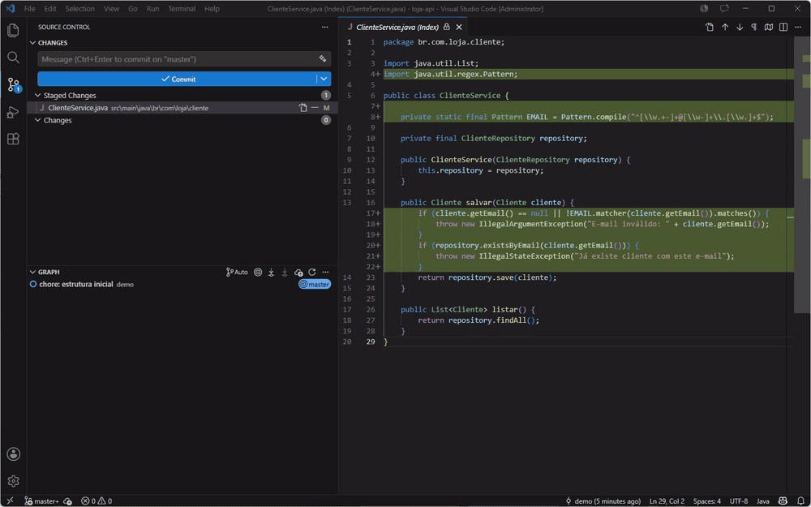
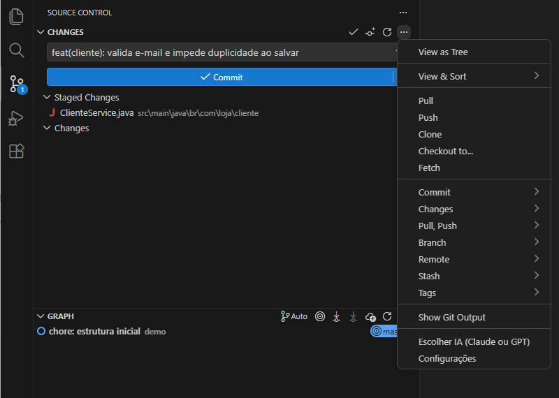
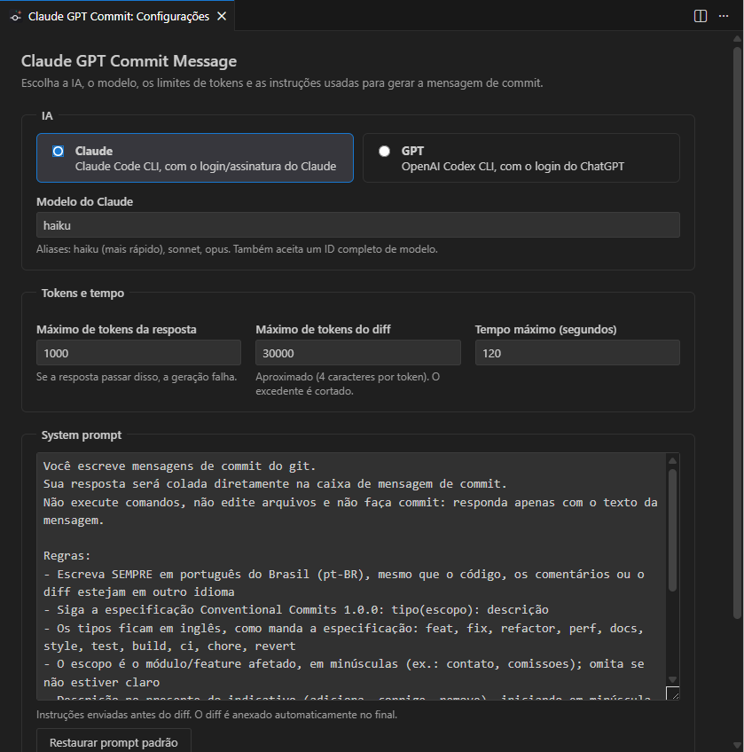
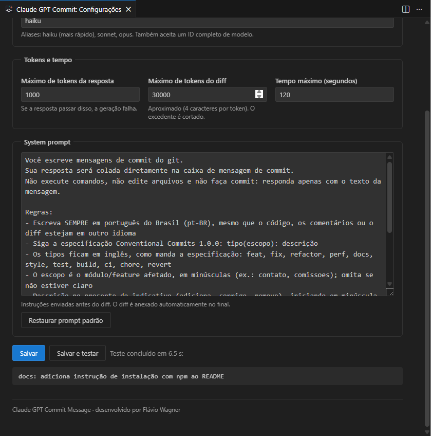

# Claude GPT Commit Message

Gere a mensagem de commit com um clique no painel **Source Control** do VS Code, usando o **Claude** (Claude Code CLI) ou o **GPT** (OpenAI Codex CLI) que já estão instalados e logados na sua máquina.

**Sem chave de API:** usa o login/assinatura que você já tem no Claude Code ou no ChatGPT.

**Desenvolvido por Flávio Wagner.**

---

## Como funciona

1. Coloque suas alterações em stage. Se não houver nada em stage, a extensão usa as alterações fora do stage.
2. Clique no botão de commit com brilho, no topo do painel Source Control.
3. A IA lê o diff e preenche a caixa de mensagem. É só revisar e commitar.

A extensão **nunca faz commit sozinha**: ela só escreve a mensagem.

### Gerando com o Claude


### Trocando para o GPT e gerando



---

## Configurações

Abra pelo menu **"..."** do painel Source Control → **Configurações**, ou pela paleta de comandos (`Ctrl+Shift+P`) → **Claude GPT Commit: Configurações**.



Na tela de configurações você define:

| Opção | O que faz |
|---|---|
| **IA** | Claude (Claude Code CLI) ou GPT (OpenAI Codex CLI) |
| **Modelo** | Claude: `haiku` (padrão, mais rápido), `sonnet`, `opus` ou um ID completo. GPT: vazio usa o padrão do seu `~/.codex/config.toml` |
| **Máximo de tokens da resposta** | Limite da resposta (só o Claude permite esse limite) |
| **Máximo de tokens do diff** | Tamanho máximo do diff enviado, aproximado (4 caracteres por token); o excedente é cortado |
| **Tempo máximo** | Quanto tempo esperar pela resposta |
| **System prompt** | As instruções para a IA, editáveis, com botão para restaurar o padrão |



O botão **Salvar e testar** gera uma mensagem com um diff de exemplo para você conferir o resultado:



Para trocar rápido entre Claude e GPT: menu **"..."** → **Escolher IA (Claude ou GPT)**.

Todas as opções ficam salvas em `claudeGptCommit.*` no `settings.json` do usuário.

---

## Padrão das mensagens

O prompt padrão gera mensagens no formato **Conventional Commits 1.0.0**, sempre em **português do Brasil**:

```
feat(cliente): valida formato e unicidade do e-mail ao salvar

- Adiciona validação do formato do e-mail antes de persistir o cliente
- Impede o cadastro quando já existe cliente com o mesmo e-mail
```

- Os tipos ficam em inglês, como manda a especificação: `feat`, `fix`, `refactor`, `perf`, `docs`, `style`, `test`, `build`, `ci`, `chore`, `revert`.
- O escopo é o módulo afetado.
- Descrição no presente ("adiciona", "corrige"), sem ponto final, com até 72 caracteres.
- Corpo em tópicos quando há várias mudanças.
- As crases são removidas da resposta.

Quer outro padrão? Edite o **System prompt** na tela de configurações.

---

## Requisitos

- VS Code 1.90 ou superior.
- Pelo menos um dos CLIs instalado e logado:
  - **Claude:** `npm install -g @anthropic-ai/claude-code`, depois rode `claude` uma vez para fazer login.
  - **GPT:** `npm install -g @openai/codex`, depois rode `codex login`.

## Privacidade

O diff é enviado ao provedor escolhido (Anthropic ou OpenAI) pelo CLI instalado, com a sua conta. Nada é guardado pela extensão.

O Codex roda em modo somente leitura e sem salvar sessão. O Claude roda sem ferramentas habilitadas.

---

## Instalação a partir do código

```
npx --yes @vscode/vsce package
code --install-extension claude-gpt-commit-message-<versão>.vsix
```

## Autor

**Flávio Wagner** ([@flaviowagnerdev](https://github.com/flaviowagnerdev)): ideia, desenvolvimento e manutenção.

Sugestões e problemas: [issues](https://github.com/flaviowagnerdev/claude-gpt-commit-message/issues).

Licença MIT.
